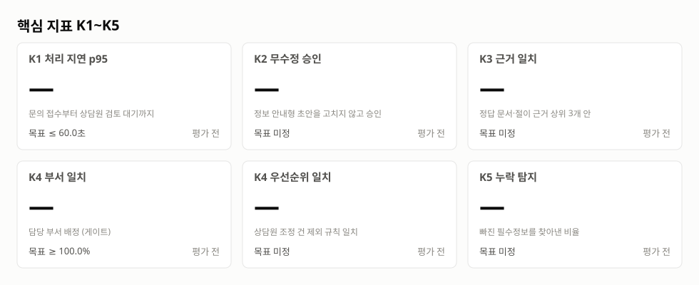
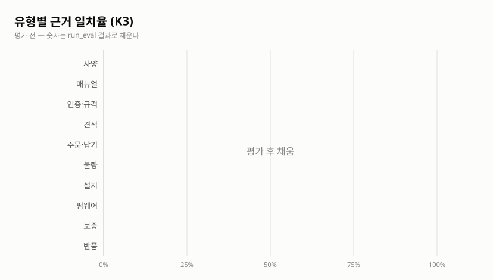
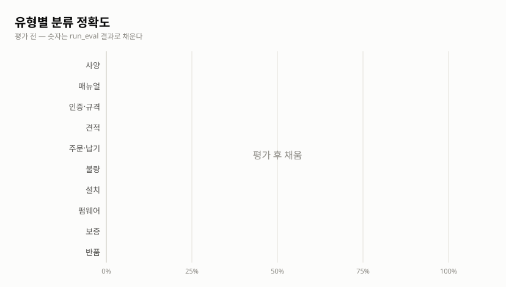
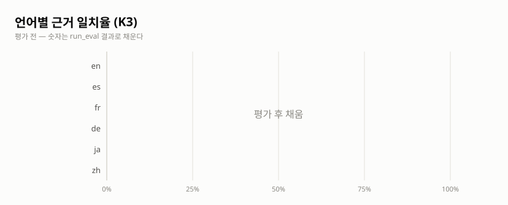
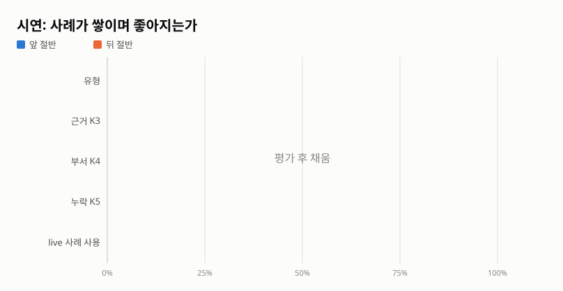

# 최종 시험 결과 (CSA-51)

> 평가 전 — 숫자는 run_eval 결과로 채운다
>
> 이 파일과 그래프는 `python -m cs_agent.evaluation.presentation <결과 JSON>` 이 만든다.

## 핵심 지표 K1~K5

| 지표 | 뜻 | 목표 | 결과 | 판정 |
|---|---|---|---|---|
| K1 처리 지연 p95 | 문의 접수부터 상담원 검토 대기까지 | ≤ 60.0초 | — | 평가 전 |
| K2 무수정 승인 | 정보 안내형 초안을 고치지 않고 승인 | 목표 미정 | — | 평가 전 |
| K3 근거 일치 | 정답 문서·절이 근거 상위 3개 안 | 목표 미정 | — | 평가 전 |
| K4 부서 일치 | 담당 부서 배정 (게이트) | ≥ 100.0% | — | 평가 전 |
| K4 우선순위 일치 | 상담원 조정 건 제외 규칙 일치 | 목표 미정 | — | 평가 전 |
| K5 누락 탐지 | 빠진 필수정보를 찾아낸 비율 | 목표 미정 | — | 평가 전 |

## 유형별

| 유형 | 처리 | 유형 | 근거 K3 | 부서 K4 | 우선순위 K4 | 누락 K5 | 지연 p95 |
|---|---|---|---|---|---|---|---|
| 사양 (TECH_SPEC) | — | — | — | — | — | — | — |
| 매뉴얼 (MANUAL) | — | — | — | — | — | — | — |
| 인증·규격 (COMPLIANCE) | — | — | — | — | — | — | — |
| 견적 (QUOTE) | — | — | — | — | — | — | — |
| 주문·납기 (ORDER_LEAD) | — | — | — | — | — | — | — |
| 불량 (DEFECT) | — | — | — | — | — | — | — |
| 설치 (INSTALL) | — | — | — | — | — | — | — |
| 펌웨어 (FW_UPDATE) | — | — | — | — | — | — | — |
| 보증 (WARRANTY) | — | — | — | — | — | — | — |
| 반품 (RETURN) | — | — | — | — | — | — | — |

## 언어별

| 언어 | 처리 | 유형 | 근거 K3 | 부서 K4 | 우선순위 K4 | 누락 K5 | 지연 p95 |
|---|---|---|---|---|---|---|---|
| en | — | — | — | — | — | — | — |
| es | — | — | — | — | — | — | — |
| fr | — | — | — | — | — | — | — |
| de | — | — | — | — | — | — | — |
| ja | — | — | — | — | — | — | — |
| zh | — | — | — | — | — | — | — |

## 틀린 건 — 담당 카드별

| 담당 카드 | 단계 | 틀린 건 |
|---|---|---|
| CSA-22 | 규칙 처리 | — |
| CSA-26 | 문의 분석 | — |
| CSA-28 | 지식 검색 | — |
| CSA-50 | 처리 실패 | — |

## 시연: 사례가 쌓이며 좋아지는가 (앞 절반 vs 뒤 절반)

| 지표 | 앞 절반 | 뒤 절반 | 변화 |
|---|---|---|---|
| 유형 | — | — | — |
| 근거 K3 | — | — | — |
| 부서 K4 | — | — | — |
| 누락 K5 | — | — | — |
| live 사례 사용 | — | — | — |
